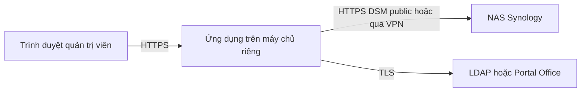

# Phương án kết nối và bàn giao hiện tại

Cập nhật 28/10/2026 (GMT+7).

## Đường kết nối vận hành được chọn

Máy chủ riêng là một máy chủ/VM triển khai của doanh nghiệp hoặc VPS được quản lý, không yêu cầu cài Python hoặc thêm máy ảo vào máy cá nhân của người dùng. Frontend nhận thao tác qua HTTPS; backend mới là thành phần kết nối NAS. Người quản trị chỉ cần trình duyệt.

Endpoint NAS SITE: `https://nassite.hbcg.vn:5001`. Các NAS khác được khai báo hostname/IP và cổng HTTPS; IP phải khớp chứng chỉ TLS. Máy chủ cần tuyến Internet/VPN phù hợp, IP đầu ra cố định nếu NAS giới hạn nguồn. VPN được hạ tầng quản lý, ứng dụng không tự dựng VPN. Chưa cần SSH. SNMPv3/collector giám sát sẽ đánh giá riêng. QuickConnect chưa được kiểm chứng là đường API tương thích.

Trên máy chủ triển khai tin cậy, thông tin được nhập trực tiếp qua form HTTPS, backend truyền tới NAS bằng HTTPS, không điền proxy placeholder vào UI DSM. Bản thử nghiệm chỉ giữ thông tin trong bộ nhớ cho login/logout; lưu lâu dài sẽ cần secret vault, phân quyền, audit và chính sách bảo vệ riêng. Không dùng tài khoản admin làm mặc định cho vận hành; xác minh quyền tối thiểu theo chức năng.

## Điều đã làm được và chưa làm được

- Môi trường GPT đã truy cập HTTPS/API discovery NAS SITE; Chromium đã tải được màn hình đăng nhập.
- Chưa có đăng nhập thành công. Auth API trả 400/101; qua UI DSM, client mã hóa đầu vào trước khi proxy GPT thay placeholder bằng secret. Không có bằng chứng mật khẩu người dùng sai.
- Chưa đọc được cấu hình có xác thực, chưa chạy chức năng quản trị thật, chưa thay đổi NAS.
- Đã có backend/form/gói Docker để kiểm chứng kỹ thuật, chưa có địa chỉ ứng dụng HTTPS được triển khai cho người dùng. Không coi container thử trong workspace là máy chủ production.
- Các kiểm thử logic/HTTP/adapter dùng mock phải tách khỏi chứng cứ NAS thật. Báo cáo UI từ phiên GPT khác chỉ hỗ trợ khảo sát, không thay thế integration test của backend.

## Hai việc tiếp theo

1. Khảo sát ngay bằng phiên GPT Công việc đã đăng nhập được: dùng `survey/prompt-gpt-cong-viec.txt`, mang báo cáo đã lọc về. Phiên này không thể tự điều khiển phiên GPT khác.
2. Chuẩn bị host thử nghiệm thực tế: máy chủ/VM có sẵn, hệ điều hành, hostname ứng dụng, chứng chỉ và cách cấp quyền triển khai an toàn. Không gửi quyền truy cập/credential trong chat. Khi có host, triển khai HTTPS rồi người dùng nhập thông tin NAS trực tiếp vào form. Không phát sinh thêm thử đăng nhập từ proxy GPT trước khi giải quyết đường credential.

## Bàn giao GitHub và gói khảo sát

Mã nguồn trước thời điểm này chỉ nằm trong workspace, chưa commit/push. Liên kết workspace không tương đương liên kết tải xuống công khai. Gói khảo sát được đặt trong `downloads/nassyno-survey-kit.zip` để tải từ GitHub sau khi push thành công. Nếu repo private, người dùng phải đăng nhập GitHub có quyền; không nhúng token vào liên kết.
